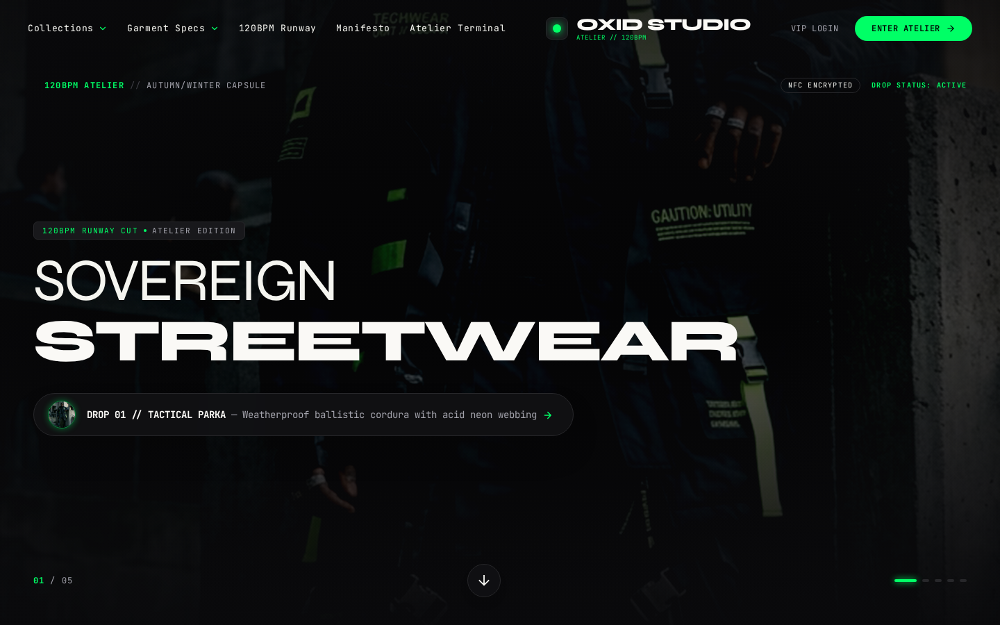

# OXID STUDIO — Landing Page Luxury Fashion Streetwear

> **Avant-Garde Luxury Streetwear Atelier & Sovereign Drop Platform**
> Redesign & Creative Engineering by OXID Labs.



## Overview
**OXID STUDIO** is an avant-garde digital storefront and drop atelier for high-fashion technical streetwear. Featuring an editorial color palette of **Hitam Doff (Matte Black: `#0a0a0c`)**, **Putih Susu (Milk White: `#faf9f6`)**, and **Neon Hijau (Acid Green: `#00ff66`)**, backed by 120BPM kinetic runway cuts, modular tactical gear specifications, and glitch-free continuous conveyor animation.

---

## Key Features & Motion Engineering
- **Sovereign Hero Carousel**:
  - Interactive split-screen cursor navigation with directional chevrons (`cursor-w-resize` / `cursor-e-resize`).
  - Staggered dual-line clip-path typography transitions with `power3.out` curves.
  - Avatar counter-zoom effect (`scale: 1.6` to `1.0`).
- **Mathematical Lookbook Conveyor**:
  - Continuous modular wrapping track algorithm with zero pixel pop/stutter.
  - Sinusoidal wave undulation on Y-axis.
  - Hover deceleration (slows down to 5% drift speed upon hover).
  - ScrollTrigger velocity boost synced to scroll speed.
- **Direct Atelier Dispatch (120 BPM Runway)**:
  - Custom 10-second 120BPM synchronized runway video loop (`oxid-runway-120bpm.mp4`).
  - Sub-bass rhythmic tempo pulse (`beat-120bpm.m4a`).
  - Device mockup with live sync indicator.
- **Creative Director Manifesto**:
  - Chiaroscuro high-fashion portrait with acid neon rim lighting.
  - Multi-layer vertical parallax scrub against oversized milk-white typography.
- **Sovereign Drop Terminal**:
  - Real-time drop telemetry mockup with dynamic allocation bar, client count, and NFC cryptographic authentication verification.

---

## Tech Stack
- **Framework**: Next.js 14 (App Router)
- **Language**: TypeScript
- **Styling**: Tailwind CSS
- **Animation**: GSAP + ScrollTrigger, Framer Motion, Lenis Smooth Scroll
- **Typography**: Syne (Brutalist Display), Space Grotesk, JetBrains Mono (Technical Spec), Inter
- **Icons**: Lucide React

---

## Getting Started

### Prerequisites
- Node.js 18+ or 20+
- npm or pnpm

### Installation
```bash
# Clone the repository
git clone https://github.com/ilhammu29/landing-page-oxid-streetwear.git
cd landing-page-oxid-streetwear

# Install dependencies
npm install

# Run development server
npm run dev
```

Open [http://localhost:3000](http://localhost:3000) with your browser to view the application.

### Production Build
```bash
npm run build
npm run start
```

---

## License
MIT © OXID Labs
